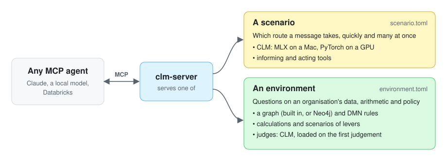

# CLM decision server

**This is a framework, not a finished product.** It supports building the tools an AI agent uses to reach the
resources where an organisation's information already lives (databases, knowledge graphs, rule tables, issue
trackers, public data) and to decide from them. You write those tools and the rules that combine them; the framework
serves them over [MCP](https://modelcontextprotocol.io) as a **decision server**, runs them, checks them and traces
every step. It holds no rules or data of its own, and decides nothing until you write the decision down.

Use it when a decision must rest on your information and your rules, not an assistant's guess: one made thousands
of times a day, such as which team handles a request, or one made once, such as whether to change supplier or open a
new site. The agent, whether Claude, a local model or one built on Databricks, talks to the person; the tools supply the
information, and the decision comes back with its reasons.

<p align="center"></p>

The framework holds you to three principles:

- **You write the rules; agents only choose among them.** Every route, rule, query, calculation and option is yours,
  and outside information reaches a decision only through your tools. An agent never invents one.
- **Every decision must be checkable.** Each one is traced to the steps that made it, figures in an agent's answer are
  checked against what the tools returned, and a decision record sets out the rules, facts, estimates and risks
  for whoever signs it off.
- **Keep it small and local where you can.** Where the server must read language it uses a Contrastive Language Model
  (CLM), which picks among options instead of writing text. It runs on a Mac or one GPU, so it costs little and the
  data stays with you; in the benchmark, Claude was more accurate.

To build your own, pick the style of decision below, start from an example ([examples/README.md](examples/README.md))
or from `uv run clm-new-environment my_environment`, write your rules and tools, and serve it with `clm-server`.

It is a prototype, built to learn how CLM behaves and to show the pattern to people who want to adapt it. It has not
been used in production, and **it is not for clinical decisions**: one example is a data service desk in a clinical
setting, and it routes questions about patient care out of scope.

## Your environment, and the decisions over it

**Your environment is the tools you define.** Some reach data where it already lives: a query over a database or
a knowledge graph, a look-up in an issue tracker, a public dataset. Some take actions: open a ticket, hold a seat,
book a hotel. Some hold your rules: DMN decision tables, calculations and limits. The framework adds nothing to
your environment; it runs your tools, records what each returned and traces every step.

**A decision runs over your environment, in one of two styles:**

| | **Routing** | **Weighing options** |
|---|---|---|
| Decides | Which route a message takes, quickly and many at once: which kind of request, how urgent, which option | A question with alternatives to compare against your rules: "should we move Product Line X to Region B, and what would it do to the Q3 margin?" |
| How | CLM reads the message, with facts from your informing tools, and picks the route; your acting tools then carry it out | Your queries supply the figures, your calculations work out each alternative, and your rules reject the ones that break a limit; the rest are ranked by an objective |
| Language model in the server | CLM, which ranks the options | None, unless a **judge** asks CLM a yes/no question of text no rule can read, such as supplier news |
| The calling agent | Talks to the person and acts on the decision | Chooses which tools and decisions to run and reports them; it never calculates, and every figure in its answer is checked |
| Written in, today | `scenario.toml`: the routes, the questions CLM answers, and the tools | `environment.toml`: the queries over a graph, the rules, the calculations and the decisions (`[scenarios.*]`) |
| Example | [service desk](examples/service_desk/README.md); [the CrowdStrike day](examples/crowdstrike/README.md), the benchmark | [tariff](examples/tariff/README.md); [new site](examples/new_site/README.md), with estimates, risk and a decision record |
| Guide | [docs/scenario.md](docs/scenario.md), [docs/walkthrough.md](docs/walkthrough.md) | [docs/environment.md](docs/environment.md) |

**Today each style has its own file**, and `clm-server` serves one file at a time, so a routing decision and a
weighing decision cannot yet share one set of tools. The file names come from that history: `scenario.toml` holds a
routing decision with its tools, and `environment.toml` holds weighing decisions with theirs. One environment serving
both styles is a possible next step, not built.

[examples/README.md](examples/README.md) lists the examples, what each shows and where to start.

A CLM does not generate text: it reads a situation and a list of options and says which option fits, with a
probability. That makes its decisions cheap, fast, local and easy to log, test and train. CLM is described in Kwok et
al. (2026) and published at [Contrastive-LM/CLM](https://github.com/Contrastive-LM/CLM); this project runs the
authors' released model with PyTorch, or the community MLX builds of it on a Mac.

## Getting started

You need Python 3.12 to 3.14, [uv](https://docs.astral.sh/uv/), and for CLM one of:

- **a Mac with Apple Silicon** and 16 GB of memory or more. CLM runs with MLX; the first run downloads about 8 GB.
- **Linux with an NVIDIA GPU of 24 GB or more**, such as an A100 or H100. CLM runs with PyTorch; the first run
  downloads about 16 GB. Switch a scenario to the torch backend in its `[clm]` table, and install a C compiler and
  Python's headers first (on Ubuntu, `sudo apt install build-essential python3.12-dev`). A plain CPU works too,
  slowly. See [docs/serving.md](docs/serving.md#on-linux).

**In a checkout,** `uv sync` installs everything, with the tests' tools, and `uv run` gives the commands below.

**As a package,** with no checkout, for example in a Databricks notebook or as a tool on another computer. The core
serves environments without judges, with keys or OAuth, in about 50 MB; extras add the rest:

```bash
pip install "clm-decision-agent @ git+https://github.com/kvnlng/clm-decision-agent"               # the core
pip install "clm-decision-agent[clm,neo4j,agent] @ git+https://github.com/kvnlng/clm-decision-agent"
uv tool install "clm-decision-agent[clm] @ git+https://github.com/kvnlng/clm-decision-agent"       # commands only
```

| Extra | Adds |
|---|---|
| `clm` | CLM (MLX on a Mac, PyTorch elsewhere): scenarios, judges, training and the example writer |
| `neo4j` | The Neo4j driver, for an environment's graph in Neo4j |
| `agent` | The Anthropic SDK, for `clm-agent` with Claude; with Ollama it needs nothing more |

A command that needs a missing extra says which, in one line. The commands are `clm-server`, `clm-agent`,
`clm-chat`, `clm-call`, `clm-new-scenario`, `clm-new-environment`, `clm-synthesize`, `clm-train`, `clm-evaluate`,
`clm-record`, `clm-load-graph`, `clm-registry` and `clm-trace-report`; each takes `--help`. In Python, the framework is `clm_decision`.

### An environment: the tariff example

```bash
uv run clm-server examples/tariff/environment.toml               # serve it over MCP, for any agent
uv run clm-agent examples/tariff/environment.toml \
    "Should we shift Product Line X's sourcing to Region B, and what would it do to Q3 margin and SLA times?"
```

`clm-agent` is a reference agent. It uses Claude through the Anthropic API by default (your usual Anthropic
credentials), or a local model through Ollama with `--backend ollama` (`gemma4:26b` by default). It answers from the
server's tools, then lists any figure no tool returned. In the example, buying half from Region B is the best branch
no limit rejects; buying all of it would earn more but is rejected, because both Region B suppliers depend on one
raw-material provider. The `sourcing_with_news` scenario adds a CLM judge of supplier news, and rejects Region B over
a strike.

The graph can live in Neo4j (the `neo4j` extra, then `clm-load-graph`):
[docs/environment.md](docs/environment.md#on-neo4j).

### A scenario: the service desk

The repository does not include trained heads, and as released CLM routes the example poorly (about half right), so
train it first. It takes under a minute on a Mac or a GPU:

```bash
uv run clm-train examples/service_desk/scenario.toml
uv run python examples/service_desk/mock_tracker.py              # terminal 1: a stand-in issue tracker
uv run clm-chat examples/service_desk/scenario.toml --review     # terminal 2: the test chat
```

The test chat starts the decision server and talks to it over MCP, as an outside agent would:

```
you> I need access to the oncology registry for an audit, needed this week
  route: Data_Access 0.65 (next: Information_Request 0.23)
  answers: urgency 1.61   identifiable 0.54
  facts: lookup_queue: Data Governance handles this kind of request. ...
  rules: urgency >= 1.5: Set the ticket's priority to High and state the deadline in the summary.
  actions: create_ticket done: {"number": 5, "url": "http://127.0.0.1:8765/..."}
```

### Your own

- **A scenario:** `uv run clm-new-scenario my_scenario` starts a folder with a working scenario, mock tools
  and labelled cases. [docs/walkthrough.md](docs/walkthrough.md) builds one step by step. In review mode, `/correct
  <route>` saves a correction; `clm-synthesize`, `clm-train` and `clm-evaluate` train CLM on examples and corrections
  and score it ([docs/fine-tuning.md](docs/fine-tuning.md)).
- **An environment:** `uv run clm-new-environment my_environment` starts a folder with a working environment, a
  team choosing where to hold an offsite, to edit into your own ([docs/environment.md](docs/environment.md)).
- **Either:** `uv run clm-call <file>` lists its tools without an agent, and `uv run clm-call <file> <tool> '<json>'`
  calls one; for a running server, give its URL instead of the file.

A mistake in either file stops start-up with one line naming the setting.

## Connecting agents

```bash
export DECISION_SERVER_KEY=<a long random key>
uv run clm-server my_scenario/scenario.toml --http                   # a shared key
uv run clm-server examples/tariff/environment.toml --http --auth oauth \
    --issuer https://login.example.org/realms/corp --audience decisions   # tokens from your identity provider
```

- **Over HTTP**, with a shared key or with OAuth: JWTs from any OIDC issuer (Keycloak, Entra ID and others), checked
  for signature, issuer, audience, expiry and scopes. [docs/serving.md](docs/serving.md).
- **In an MCP registry**, so agents can find a deployment: `clm-registry` writes its `server.json`, for the public
  registry or a private one. [docs/registry.md](docs/registry.md).
- **Traced**: `--trace FILE` records where each call's time went and who called; `clm-trace-report` summarises it.
- **Reference agent:** `clm-agent` takes a running server's URL as well as a file, with the key in
  `DECISION_SERVER_KEY`.
- **Databricks:** not tried yet. [docs/serving.md](docs/serving.md#databricks) says what it needs.

**A scenario's server acts without asking.** When a decision calls for an acting tool, the tool runs at once, unless
the route is uncertain; calling `decide` twice acts twice. Point acting tools at real systems with care. An
environment's tools only read. Read [docs/data-handling.md](docs/data-handling.md) before any real text goes in.

## The server's tools

For a scenario:

| MCP tool | What it does |
|---|---|
| `decide(text, context)` | The route with its probabilities, `uncertain` below the threshold, each question's answer, the rules that apply, the facts found, the option chosen, and what the acting tools did |
| `decide_many(requests)` | The same for up to 1000 requests at once, faster per request |
| `check_call(text, call)` | CLM's opinion of a tool call the caller proposes: a probability and approved yes or no |
| `describe()` | The routes, options, questions, rules and tools |
| `correct(...)`, `agreement()` | Review mode only: save the right decision; how often CLM agrees with the corrections |

For an environment:

| MCP tool | What it does |
|---|---|
| `describe` | The environment and every part, with its parameters, levers, objective and limits |
| `query_<name>`, `decision_<name>`, `calculation_<name>` | One named part, with typed arguments |
| `scenario_<name>` | Every branch, or those asked for: figures, kept or rejected, the limits that rejected it, and every step |
| `judge_<name>` | CLM's probability that the judge's question is answered yes for a text |
| `rules`, `rule` | When the rules carry metadata: those governing a topic, with why each exists and what to ask for; one rule's rows |

## What to expect

Measured on an M5 Max with 64 GB unless a GPU is named. Small tests, said plainly.

- **CLM must be trained.** On the service desk the released heads routed 51% of held-back examples right; trained
  on 199 generated examples, 98%.
- **Against Claude, on the CrowdStrike day's 600 check cases, Claude was more accurate and, on the Mac, faster.**
  Sonnet 5.5 got 82% of routes right and Haiku 5.5 79%, against CLM's 75%; each took about 267 ms a decision to
  CLM's 300 ms. CLM's strengths are cost and place: $0 for the day's 99,806 decisions against about $15 (Haiku) or
  $158 (Sonnet), the messages never leave the machine, and it marked 119 of its 152 wrong routes uncertain, so they
  went to a person ([the comparison](examples/crowdstrike/README.md)).
- **On a data-centre GPU CLM is much faster:** 3.6 decisions a second on the Mac, about 19 on an A100 and 50 on an
  H100, against a peak need of 10.7 on the CrowdStrike day ([docs/findings.md](docs/findings.md)).
- **CLM's probabilities are relative, not calibrated.** Tune thresholds on labelled cases; the tariff news judge
  separated risks from harmless news by a gap of only 0.05.
- **In the tariff example, Claude and a local `gemma4:26b` reached the same decision** by the same two calls in
  eight runs. Claude's answers were fuller and explained the dependency; once it worked out a figure itself, which
  the number check flagged. gemma4 was free and stayed on the Mac, but with news available it did not run the
  scenario that checks it and missed the strike ([the runs](examples/tariff/README.md#what-happened-when-the-models-were-asked)).

## Layout

The framework is the package `clm_decision`, in `src/clm_decision/`:

| Module | Purpose |
|---|---|
| `server.py` | `clm-server`: MCP over stdio or HTTP, for a scenario or an environment |
| `scenario.py`, `decision.py`, `tools.py` | Reads a scenario; one decision; loads its tools |
| `environment.py`, `environment_server.py`, `engine.py` | Reads an environment; its parts as MCP tools; queries, decisions, scenarios and judges run with every step recorded |
| `graph.py`, `graph_neo4j.py`, `load_graph.py`, `dmn.py` | The built-in graph; named queries on Neo4j; `clm-load-graph`; DMN decision tables |
| `decision_agent.py`, `number_check.py`, `decision_record.py` | `clm-agent`, Claude or a local model; the check that every figure came from a tool; the decision record |
| `call.py` | `clm-call`: a server's tools, listed or called by hand, over stdio or HTTP |
| `oauth.py`, `registry.py` | OAuth tokens from any OIDC issuer; `clm-registry`, the `server.json` for an MCP registry |
| `tracing.py`, `trace_report.py` | `--trace`, and `clm-trace-report` |
| `chat.py` | `clm-chat`, the test chat for scenarios |
| `clm_router.py`, `clm_torch.py`, `clm_schema.py`, `clm_common.py` | CLM with MLX or PyTorch; routing and the reuse of corrections; the authors' question format, unchanged |
| `record.py`, `evaluate.py`, `new_scenario.py`, `new_environment.py` | Corrections (`clm-record`) and their scoring (`clm-evaluate`); `clm-new-scenario`, `clm-new-environment` |
| `dataset.py`, `synthesize.py`, `train.py`, `generator.py` | `clm-train`; `clm-synthesize` and the language model that writes examples |

Outside the package:

| Folder | Purpose |
|---|---|
| `examples/` | The worked examples: `service_desk/`, `crowdstrike/`, `tariff/` and `new_site/` |
| `docs/` | Guides: scenario, walkthrough, environment, serving, registry, fine-tuning, models, findings, data handling |
| `tests/` | `uv run pytest` (no models needed); `uv run pytest -m slow` (loads CLM; `CLM_TEST_BACKEND=torch` for torch) |

## Licence

Copyright 2026 Kevin Long. Licensed under the [Apache License 2.0](LICENSE). The licence covers this repository only:
the models it downloads have their own terms.
