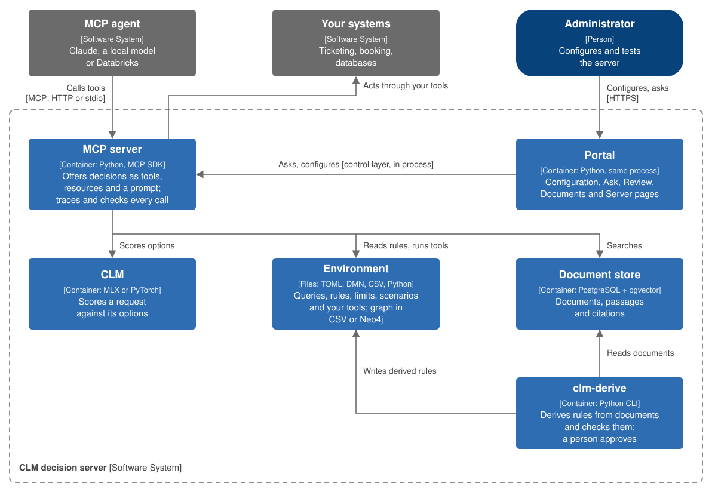

# CLM decision server

**A framework, not a finished product.** You write the tools an AI agent uses to reach the resources where your
information already lives (databases, knowledge graphs, rule tables, issue trackers, public data) and the rules
that combine them. The framework serves them over [MCP](https://modelcontextprotocol.io) as a **decision server**:
it runs them, checks them and traces every step. It holds no rules or data of its own and decides nothing until
you write the decision down.

Use it when a decision must rest on your information and rules, not an assistant's guess: one made thousands of
times a day (which team handles a request) or once (whether to change supplier or open a new site). The agent,
whether Claude, a local model or one built on Databricks, talks to the person; your tools supply the information;
the decision comes back with its reasons.

Three principles:

- **You supply the rules, or they are derived and checked; agents only choose.** Information reaches a decision
  only through your tools. A derived rule decides only once it passes its checks and a person approves it; every
  result says whether its rule was supplied or derived.
- **Every decision is checkable.** Every step is traced, every figure checked and a decision record kept.
- **Small and local where you can.** CLM picks among options on a Mac or one GPU: cheap, and your data stays with
  you. Claude was more accurate in the benchmark.

**[Getting started](docs/getting-started.md)** covers your environment and the two styles of decision, installing,
the examples, building your own and connecting agents. This is a prototype, not used in production and **not for
clinical decisions**; a scenario's server runs its acting tools without asking.

## Tools

Which MCP tools a decision server offers depends on the style of decision.

### Routing: a scenario (`scenario.toml`)

The tools are a fixed set; your informing and acting tools run inside `decide`, not as tools of their own. `decide`
returns the route with its probabilities (`uncertain` below the threshold), the rules applied, the facts found, the
option chosen and what the acting tools did. `decide_many` does the same for up to 1000 requests at once.
`check_call` gives CLM's opinion of a tool call the caller proposes, and `describe` lists routes, options, questions,
rules and tools. In review mode only, `correct` saves the right decision and `agreement` reports how often CLM
agrees. Details: [docs/scenario.md](docs/scenario.md#tools).

### Weighing options: an environment (`environment.toml`)

There is one tool for each part you write, named after it (`query_`, `decision_`, `calculation_`, `scenario_`,
`judge_`, `search_`, `document_`, `cites_`, `cited_by_`), plus `describe` and, when the rules carry metadata, `rules`
and `rule`. The agent explores the parts and runs the ones it needs. The same code serves read-only **resources**
(`describe`, each rule, each document and passage, the derived rules in force) and one **prompt**,
`answer_question`, the reference agent's instructions. The reads stay tools too, since most agents fetch only
through tools. Details: [the tools](docs/environment.md#the-mcp-tools),
[the resources and prompt](docs/environment.md#resources-a-prompt-and-context); the
[MCP Inspector](docs/serving.md) lists and calls all of them.

## What to expect

These are small tests, said plainly in [docs/findings.md](docs/findings.md):

| Finding | Measured |
|---|---|
| Train CLM first | Service desk, 55 held-back generated examples: 51% of routes right as released, 98% trained |
| Claude is more accurate, and faster on a Mac | CrowdStrike day, 600 unseen cases, Apple M5 Max (64 GB, MLX, 8-bit CLM), Claude through the API with 8 calls at once: Sonnet 5.5 82%, Haiku 5.5 79%, CLM 75%; Sonnet took 267 ms a decision, CLM 300 ms. CLM costs nothing to run, keeps data local and marks most of its wrong answers uncertain |
| A GPU makes CLM fast | The day replayed: 3.6 decisions a second on the Mac, 19.2 on an A100 80 GB, 51.1 on an H100 80 GB SXM (torch, bf16) |
| CLM's probabilities are relative | Tune thresholds on labelled cases |
| Rules can be derived from your documents; a person still reviews them | Claude derived the handbook's 11 rules and figures, all matching the hand-written ones. A local model (gemma4) put two figures in the wrong place: the mechanical check missed them, and a second reading by Claude caught them. One run each |

## Layout

| Path | Holds |
|---|---|
| `src/clm_decision/` | The framework and the `clm-*` commands |
| `examples/` | Six worked examples ([the list](examples/README.md)) |
| `docs/` | The guides, starting with [getting started](docs/getting-started.md) |
| `portal/` | [The portal](portal/README.md): a local page for administering a server, and a command-line chat; not part of the package |
| `tests/` | `uv run pytest`; `uv run pytest -m slow` also loads CLM (`CLM_TEST_BACKEND=torch` for torch) |

## Licence

Copyright 2026 Kevin Long. Licensed under the [Apache License 2.0](LICENSE). The licence covers this repository only:
the models it downloads have their own terms.
