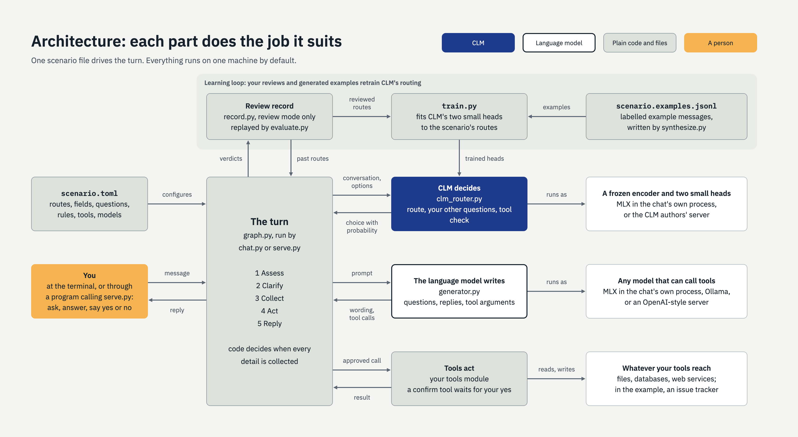
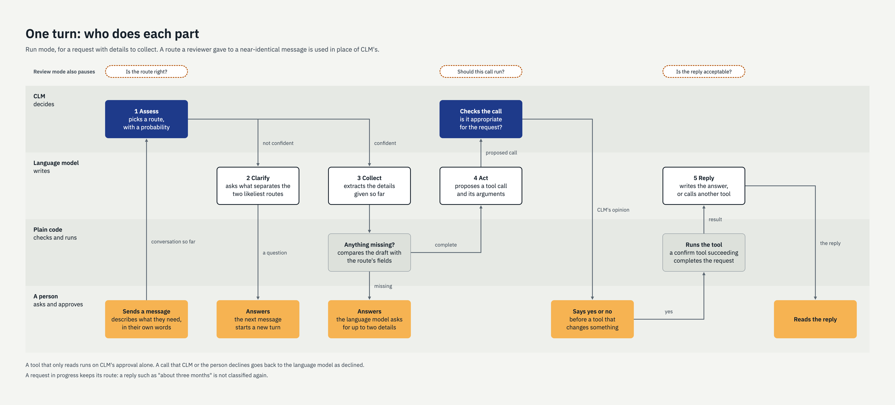

# CLM decision agent

A small framework for building a chat assistant that makes **narrow, checkable decisions**
with a Contrastive Language Model (CLM) and uses a language model only to write. Everything
runs on one machine.

It is a prototype, built to learn how CLM behaves and to show the pattern to people who want
to adapt it. It has not been used in production.

**It is not for clinical decisions.** The example is a data service desk in a clinical
setting; it declines questions about patient care.

## The idea

A language model generates text. A CLM does not: it reads a situation and a list of options
and says which option fits, with a probability. That makes its decisions cheap, fast, and
easy to log, test and train.

This framework gives each model the job it is suited to:

| Job | Done by |
|---|---|
| Which kind of request is this? What are the answers to the scenario's other questions? Is this tool call appropriate? | CLM |
| Asking questions, writing replies, wording what a tool submits, choosing tool arguments | The language model |
| Is every required detail collected? | Plain code |
| Should this action, which changes something, go ahead? | The user |
| Was CLM's decision right? | A reviewer, whose answers are saved and reused |

All of it is driven by one file, the **scenario**, which lists the kinds of request, what to
collect for each, the questions to ask CLM, and the tools.



## Quick start

You need an Apple Silicon Mac, Python 3.12 or later, and [uv](https://docs.astral.sh/uv/).
The first run downloads about 11 GB of models.

```bash
uv sync
uv run python examples/service_desk/mock_tracker.py                     # terminal 1
uv run python train.py examples/service_desk/scenario.toml              # terminal 2, once
uv run python chat.py examples/service_desk/scenario.toml --review      # terminal 2
```

Then type, for example, `I need access to the oncology registry`.
[examples/service_desk/README.md](examples/service_desk/README.md) walks through the demo.

## How a turn works

1. **Assess.** CLM reads the conversation and picks a route, and answers the scenario's other
   questions. If a reviewer has seen a near-identical message before, their route is used.
2. **Clarify or continue.** If CLM is not confident, the language model asks the user a
   question that would tell the two likeliest routes apart.
3. **Collect.** If the route lists details to collect, the language model extracts what the
   user has given and asks for the rest. Code decides when nothing is missing.
4. **Act.** The language model proposes tool calls. CLM gives an opinion on each. A tool that
   changes something waits for the user's yes.
5. **Reply.** The language model writes the answer.



In **review mode** (`--review`) the assistant pauses at each decision for your verdict and
saves it. In **run mode** it does not pause, except before a tool that changes something.

## Commands

| Command | What it does |
|---|---|
| `chat.py <scenario> [--review]` | Talk to the assistant |
| `serve.py <scenario> [--port N]` | Answer HTTP requests instead, for one user: [docs/serving.md](docs/serving.md) |
| `synthesize.py <scenario>` | Have the language model write labelled example messages |
| `train.py <scenario>` | Fit CLM to the scenario using those examples and your reviews |
| `evaluate.py <scenario>` | Replay your reviews: how often does CLM agree with you? |
| `record.py purge <scenario>` / `newkey <file>` | Delete the review record / make an encryption key |

Run each with `uv run python`.

## Adapting it

1. Copy `examples/service_desk/` and edit `scenario.toml`: [docs/scenario.md](docs/scenario.md).
2. Write your tools in a Python file beside it (same guide).
3. Choose where the models run: [docs/models.md](docs/models.md).
4. Train CLM on your routes: [docs/fine-tuning.md](docs/fine-tuning.md).
5. Read [docs/data-handling.md](docs/data-handling.md) before any real text goes in.

## What to expect

Measured on the example scenario, on an M5 Max with 64 GB:

- **Untrained, CLM routes poorly**: 8 of 20 hand-written test messages. Trained on 318
  generated examples it gets 16 of 20, and its wrong answers come with low confidence. Twenty
  messages is a small test.
- **CLM's probabilities are relative, not calibrated.** Treat the confidence threshold as a
  setting to tune with `evaluate.py`, not as a probability of being right.
- **The language model makes mistakes too**: it can mis-extract a detail or word a
  submission badly. That is why a tool that changes something needs a yes.
- **A turn takes a few seconds** with the default 4-billion-parameter language model.

## Layout

| File | Purpose |
|---|---|
| `scenario.py` | Reads and checks a scenario file |
| `clm_router.py` | CLM decisions, local or from a server |
| `generator.py` | The language model backends |
| `graph.py` | The turn, as a LangGraph graph |
| `chat.py` | The terminal |
| `serve.py` | The same turn over HTTP, as a demonstration |
| `tools.py` | Loads a scenario's tools |
| `record.py`, `evaluate.py` | The review record and its replay |
| `dataset.py`, `synthesize.py`, `train.py` | Training |
| `examples/service_desk/` | The worked example |
| `mlx_clm_triage.py` | A single CLM call, the smallest possible example |
| `tests/` | `uv run pytest` (no models needed); `uv run pytest -m slow` (loads the models) |

CLM is described in Kwok et al. (2026) and published at
[Contrastive-LM/CLM](https://github.com/Contrastive-LM/CLM). This project uses the community
MLX builds of it.
