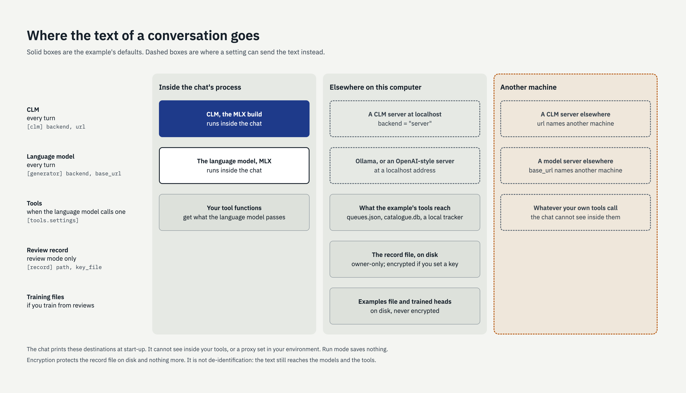

# Handling sensitive text

Read this before real text goes into an assistant built on this framework. It describes what
the code does. It is not legal or compliance advice, and nothing here makes a deployment
compliant with any regulation.

## Where text goes

During a conversation the user's words reach:

| Place | When | You control it with |
|---|---|---|
| CLM | Every turn | `[clm] backend`, `url` |
| The language model | Every turn | `[generator] backend`, `base_url` |
| Your tools, and whatever they call | When the language model calls one | Your tools module and `[tools.settings]` |
| The review record, on disk | Review mode only | `[record]` |
| The examples file and trained heads, on disk | If you train from reviews | Where you keep those files |

With the default settings both models run inside the chat's process and nothing leaves the
machine except what your tools send.

`serve.py` sends text to the same places. It accepts requests from this computer only and keeps
its one conversation in memory, so it saves nothing either: [serving.md](serving.md).



**The chat prints this at start-up**, saying for each model whether text stays in the
process, goes to a server on this computer, or goes to another machine, and whether the
record is encrypted. Its limits:

- It cannot see inside your tools.
- "On this computer" means the address is `localhost`, `127.0.0.1` or `::1`. It does not know
  about a proxy configured in your environment, which could carry that traffic elsewhere.
- With Ollama it says only that text goes to the Ollama server your computer is set up to use.
- It warns if LangSmith tracing is switched on in your environment, because LangChain would
  then upload prompts. It does not know about other tracing or logging you have added.

Run mode saves nothing.

## Keep sensitive text out

This is the protection that matters most, and the framework cannot do it for you.

- Design routes and fields so the assistant never needs patient-level details. The example
  collects "which dataset" and "what for", not records.
- Give the assistant a route for requests it must not handle, and say in each route's prompt
  what must not be copied into outputs.
- Tell users what not to type. **Nothing stops them typing it anyway**, and a prompt telling
  the language model not to repeat something is an instruction, not a safeguard.
- Have tools return the least they can. Whatever a tool returns is shown to the language
  model and may appear in a reply.

## Protect the record

The record (`<scenario>.record.jsonl`) holds the conversation text of everything reviewed.

```toml
[record]
path = "private/my.record.jsonl"     # keep it somewhere other than beside the scenario
key_file = "record.key"              # encrypt each line with this key ...
# key_env = "RECORD_KEY"             # ... or with a key held in an environment variable
```

- The file is created readable by its owner only.
- `uv run python record.py newkey record.key` makes a key. Keep it out of version control,
  and back it up: a record written with a key cannot be read without it.
- `uv run python record.py purge <scenario>` deletes the record, after asking.
- Lines the chat cannot read (a wrong or missing key, or damage) are counted and reported at
  start-up, not silently ignored. Review mode refuses to start if the record holds lines
  written with a different key, because adding to it would leave a file no single key can read.
- `purge` only deletes a file that is plainly a review record, since `path` can name any file.

## What encryption does not do

- It protects the record file at rest. Anyone with the key, or with access to the running
  process, can read the text.
- It is not de-identification. The text is unchanged, and it is still sent to the models and
  tools.
- The examples file and the trained heads are not encrypted. If you train from reviews, the
  heads are derived from that text; store them as carefully as the record.
- There is no key rotation. To change the key, purge the record and start a new one.
- Lines written before you set a key stay unencrypted in the same file.
- Server addresses in a scenario may not contain a user name or password; put a key in the
  variable named by `api_key_env`, which is never printed.

## Before using real text

- [ ] Start the chat and read the "Where conversation text goes" lines. Is every destination
      one you intend?
- [ ] Check what each of your tools sends, and where.
- [ ] Decide where the record, the examples file and the trained heads live, who can read
      them, and how long they are kept.
- [ ] If the record is encrypted, decide who holds the key and where its backup is.
- [ ] Try typing something the assistant should refuse, and see what happens to it.
- [ ] Have whoever is responsible for information governance where you work look at this
      list.
