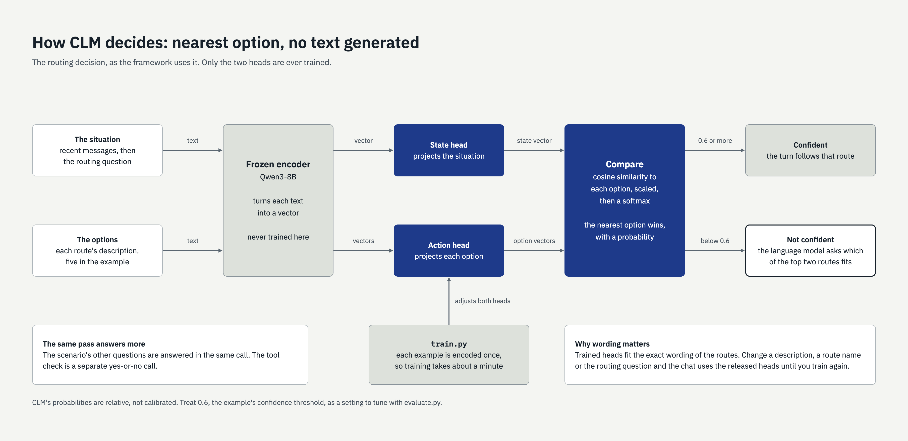

# Choosing and pointing at models

A scenario names two models. Both can run in the chat's own process or on a server.

## CLM

CLM is a frozen encoder (Qwen3-8B) with two small "heads" on top. The encoder turns text into
a vector; one head projects the situation, the other projects each option, and the answer is
whichever option lands closest.



### In this process (the default)

```toml
[clm]
model_id = "mlx-community/CLM-v0.1-8B-MLX-8bit"
heads = "scenario.heads"     # optional: heads trained for this scenario
```

This uses the community MLX builds, which run on Apple Silicon.

| Build | Download | Agreement with the original | Use it when |
|---|---|---|---|
| `...-MLX-8bit` | 8 GB | 99.0% of top answers | You want CLM as its authors released it |
| `...-MLX-4bit` | smaller | 91.4% | Memory is tight and approximate answers are acceptable |

- "8-bit" and "4-bit" describe how much the encoder's numbers were compressed. The 8-bit build
  keeps the released heads unchanged. The 4-bit build's heads were re-fitted to a more
  compressed encoder, so its answers differ more.
- The agreement figures are the build publishers' own.
- **Heads only work with the encoder build they were made for.** Heads trained with the 8-bit
  build must be used with the 8-bit build; the chat checks this.

### On the CLM authors' server

```toml
[clm]
backend = "server"
url = "http://localhost:8700"
api_key_env = "CLM_API_KEY"      # optional: the variable holding the server's key
model = "clm-latest"
```

The authors' `clm-serve` needs a GPU machine. This backend follows their server code but
**has not been run against a real server**. Two things differ from the local backend:

- A reviewer's route is reused only when the conversation text is exactly the same, because
  the server returns answers and not the vectors that "near-identical" matching needs.
- `train.py` does not apply. Train and load heads on the server with the authors' tools.

## The language model

Any model that follows instructions and can call tools will do.

```toml
[generator]
backend = "mlx"                                       # in this process
model = "mlx-community/Qwen3-4B-Instruct-2507-4bit"
```

```toml
backend = "ollama"                                    # a local Ollama server
model = "gemma4:26b"
```

```toml
backend = "openai"                                    # any server with the OpenAI chat interface
base_url = "http://localhost:11434/v1"                # Ollama, vLLM, LM Studio, llama.cpp ...
model = "gemma4:26b"
api_key_env = "MODEL_API_KEY"                         # optional
```

All three have been run with the example. What we saw:

| | Qwen3-4B (in process) | Gemma 26B (Ollama) |
|---|---|---|
| Extracting collected details, 20 fields | 18 right | 19 right |
| Time for five extractions | 1.3 s | 18 s, including loading |
| Size on disk | 2 to 3 GB | 18 GB |

The small model is the default because extraction runs on every turn. A larger one is more
likely to matter for the wording of what is finally submitted. Both fit beside the 8-bit CLM (about
9 GB in use) on a 64 GB machine.

`base_url` can point at a machine other than yours. The chat prints where text is going at
start-up; see [data-handling.md](data-handling.md).
