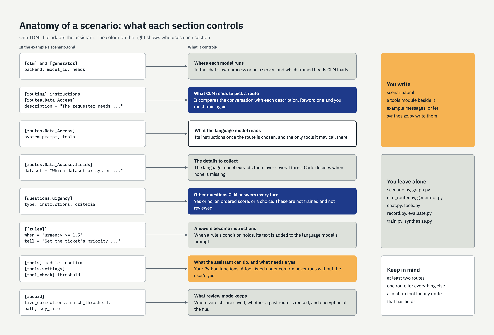

# Writing a scenario

A scenario is one TOML file. Start from
[examples/service_desk/scenario.toml](../examples/service_desk/scenario.toml), which uses
everything described here. A mistake in the file is reported as one line naming the setting.



## Routes

A route is one kind of request. You need at least two.

```toml
[routing]
instructions = "What does the requester need?"   # the question CLM is asked
confidence_threshold = 0.6                       # below this, the assistant asks to clarify

[routes.Data_Access]
description = "The requester needs access to an existing dataset or system."
system_prompt = "You help staff open a request for access to data. Be brief."
tools = ["find_dataset", "create_ticket"]        # optional
examples = ["Can I get into the oncology registry?"]   # optional; shown by `help`
```

- **`description` is what CLM reads.** It compares the conversation with each description, so
  wording matters more than anything else in the file. Full sentences that describe the
  person's need work better than labels. If you train CLM, changing a description means
  training again.
- **`system_prompt` is what the language model reads** when the route is chosen.
- **Include a route for everything else.** CLM always picks one of the routes, so without an
  "out of scope" route an unrelated message lands on a real one.
- Route names may not be `assess`, `clarify`, `tools`, `verify_tool`, `decline_tool`,
  `review_route`, `review_tool`, `review_reply`, `settle` or `confirm_tool`.

## Details to collect

Give a route `fields` and the assistant collects them over as many turns as it takes.

```toml
[routes.Data_Access.fields]
dataset = "Which dataset or system they need access to"
purpose = "What they will use it for"
```

- The text is what to ask for; the name on the left is for the code.
- The language model extracts values; code decides when all are present. "Not sure" is not
  accepted as a value.
- While details are being collected the conversation stays on that route. The user types
  `new` to abandon it and `draft` to see it.
- A route with fields must have at least one tool listed under `confirm` (below). That tool
  succeeding is what completes the request.

## Questions for CLM

Besides the route, CLM can answer other questions about each message.

```toml
[questions.identifiable]
type = "noul"                                    # yes or no; the answer is 0 to 1
instructions = "Does this request involve data that identifies individual patients?"

[questions.urgency]
type = "score"                                   # ordered levels; the answer is the expected level
instructions = "How soon is this needed?"
criteria = ["No deadline is mentioned", "Needed within weeks", "Needed within days"]

[questions.team]
type = "choice"                                  # one of several options
instructions = "Which team should handle this?"
criteria = { reporting = "Dashboards and reports", data = "Tables and data quality" }
```

The answers are shown in the terminal and given to the language model as a "Signals" line.
They are not trained by `train.py`, and nobody reviews them; check them by eye before
relying on them.

## Rules

A rule turns one of CLM's answers into an instruction for the language model.

```toml
[[rules]]
when = "urgency >= 1.5"
tell = "Set the ticket's priority to High and state the deadline in the summary."
```

`when` is `<question> >= <number>` or `<= <number>` for yes/no and score questions, and
`<question> == <option>` for choice questions.

## Where information comes from

**Information from outside the framework reaches the assistant only through tools** in the
scenario's tools module. The framework itself holds no code for any data source. A tool has one
of two roles, or both:

| Role | Called by | When | Its result goes to | Safeguards |
|---|---|---|---|---|
| Model tool | The language model | When it decides to | The language model | CLM checks the call; a `confirm` tool waits for the user's yes |
| Context tool | The framework | At a fixed point (the catalogue: start-up) | CLM and the language model | A contract, checked by the framework |

The framework's own files are not outside information: the scenario, the review record, the
example messages and the trained heads.

## Tools

Tools are ordinary Python functions in a file beside the scenario.

```toml
[tools]
module = "service_desk_tools"      # service_desk_tools.py beside this file
confirm = ["create_ticket"]        # tools that change something: never run without the user's yes

[tools.settings]                   # passed to your module; any keys you like
tracker_url = "http://127.0.0.1:8765"
```

The module defines `TOOLS`, a list of functions decorated with LangChain's `@tool`, and
optionally `configure(settings, scenario_dir)`, which is called once at start-up.
[service_desk_tools.py](../examples/service_desk/service_desk_tools.py) shows a file lookup,
a data catalogue read from OpenMetadata, and calls to an issue tracker.

- The function's docstring is what the language model reads to decide when to call it.
- A route can only use the tools it lists.
- To report a failure, raise `ToolException("what went wrong")`. The language model is told,
  and a failed `confirm` tool leaves the request open.
- **Put every safeguard in the tool itself.** Validate arguments, use parameterised queries,
  and check permissions there. CLM's check on a tool call is advice; untrained, it
  agreed with a reviewer only a little more than half the time.

```toml
[tool_check]
instructions = "Is this tool call appropriate for what the user asked?"
threshold = 0.5          # below this a call is declined (confirm tools ask the user instead)
max_tool_rounds = 3      # tool-calling steps allowed in one turn
```

## Catalogue

A catalogue lets CLM choose *which thing* a request is about (a dataset, a system, a product)
from a list your own source supplies, and lets what is known about it inform the decision.

```toml
[catalogue]
tool = "list_datasets"              # a tool in TOOLS: the context tool
routes = ["Data_Access"]            # the routes it applies to
field = "dataset"                   # the field a confident choice fills; each route must have it
instructions = "Which dataset does the requester mean?"
confidence_threshold = 0.5          # below this the choice is not used
questions = ["identifiable"]        # optional: the questions the facts bear on (default: all)
```

On a listed route, once a turn, CLM chooses between the entries' descriptions. A choice at or
above the threshold fills the field, and the entry's facts are added to what CLM reads before it
answers the listed questions again, so the rules can respond to them. List only the questions
the facts bear on: they sway others too. In the example, a dataset's owner and sensitivity
raised the urgency of a message that gave no deadline. The language model
sees the facts too. Below the threshold nothing changes: the language model asks. The facts
never reach the routing decision, so reviewed routes and trained heads are unaffected.

**The catalogue tool must:**

1. be a LangChain tool in `TOOLS`, taking no required arguments (it is called as `tool.invoke({})`);
2. return between 2 and 50 entries, each `{"name": str, "description": str, "facts": [str, ...]}`:
   - `name`: non-empty and unique; it fills the field and is shown to the user;
   - `description`: one or two plain sentences on what the entry is. CLM matches the
     conversation against it, so it carries most of the decision;
   - `facts`: plain sentences, possibly none, each understandable on its own;
3. report failure by raising `ToolException` with a message a person can act on.

It **may** read from anywhere, keep what it read, and be listed in a route's `tools` as well. It
**should not** send conversation text anywhere; called at start-up, it has none.

The framework calls it once, at start-up. A failure, or a result that breaks the contract, stops
start-up with one line naming the rule. A source with more than 50 entries narrows them itself,
for example by domain. CLM has not been trained on your entries, so expect its choice to be
less confident than its routing: in the example, 2 of 4 test messages were matched, and the two
misses were below the threshold.

## Reviewing and reuse

```toml
[record]
live_corrections = true    # reuse a reviewer's route for a near-identical message
match_threshold = 0.97     # how similar "near-identical" must be, 0 to 1
```

In review mode each route, tool call and reply you judge is saved to the record. Afterwards:

- a message close enough to one you reviewed gets your route, whatever CLM says;
- `evaluate.py` replays the record and suggests a confidence threshold;
- `train.py` learns from the routes you chose.

Settings for where the record is kept and for encrypting it are in
[data-handling.md](data-handling.md). Settings for the models are in [models.md](models.md).

## Other settings

| Setting | Default | Meaning |
|---|---|---|
| `[clm] history_turns` | 6 | How many of the user's recent messages CLM sees |
| `[generator] max_tokens` | 400 | Longest reply the language model may write |
| `[synthesize] messages` | "messages that a person might send to an assistant" | What `synthesize.py` asks the language model to write: say who is writing and to what |
