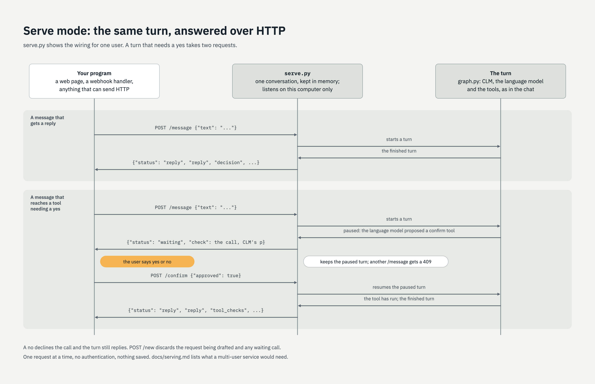

# Answering HTTP requests

`serve.py` runs the same turn as the chat, but answers HTTP requests instead of a terminal, so
another program (a web page, a webhook handler) can call the assistant.

**It shows the wiring and is not a service.** It holds one conversation for one user, in
memory, and accepts requests from this computer only, with no authentication. The last
section lists what a multi-user service would need.



## Run it

```bash
uv run python serve.py <scenario> [--port 8780]
```

It loads the scenario and models as the chat does, prints where text goes, and listens on
`127.0.0.1`. It always runs in run mode: routes you reviewed in the chat are reused, nothing
is saved, and reviewing stays in the terminal.

## The calls

Bodies and answers are JSON.

| Call | Body | Answer |
|---|---|---|
| `POST /message` | `{"text": "..."}` | A reply, or a tool call waiting for a yes |
| `POST /confirm` | `{"approved": true}` or `false` | A reply, or another call waiting |
| `POST /new` | none | Discards the request being drafted and any waiting call; the conversation is kept |
| `GET /` | | The scenario's routes, the draft so far, and whether a call is waiting |

A reply carries what the chat prints for a turn:

```json
{"status": "reply",
 "reply": "What will you use it for?",
 "decision": {"route": "...", "confidence": 0.99, "source": "clm", "probabilities": {}, "answers": {}},
 "intake": {"filled": 1, "total": 4, "missing": ["..."]},
 "tool_checks": []}
```

When the language model proposes a tool listed under `confirm`, the turn stops and the answer
is the call instead, with CLM's opinion of it (`p`):

```json
{"status": "waiting",
 "check": {"calls": [{"name": "...", "args": {}}], "p": 0.63, "approved": true, "source": "clm"}}
```

Show the call to the user and send their answer to `/confirm`. Until you do, `/message` is
refused with status 409. For example:

```bash
curl -s -X POST http://127.0.0.1:8780/message -d '{"text": "<the last detail the request needs>"}'
curl -s -X POST http://127.0.0.1:8780/confirm -d '{"approved": true}'
```

Other statuses: 400 for a body that is not what the call expects, 404 for an unknown path,
409 for `/confirm` with nothing waiting, and 502 with the reason when CLM or the language
model cannot be reached. After a 502 the conversation is as it was before the turn began, and no call is left waiting.

## What it does not do

- **One conversation.** Every caller shares it. A restart forgets it.
- **One request at a time.** A second request waits for the first to finish.
- **No authentication and no encryption in transit.** That is why it listens on this
  computer only. To reach it from elsewhere, put a reverse proxy in front and add both there.
- **The caller decides who may say yes.** Whoever can reach `/confirm` can approve the call.

## Towards a multi-user service

None of this is built. It is what we would expect to need, roughly in the order it bites.

- **A conversation key from the caller.** A webhook says "this is about thread X", so each
  request names its conversation and the server finds or creates the state for it.
- **A user id from the caller**, kept with the conversation, so one person cannot continue,
  see or approve another's request.
- **Identity checked by the layer in front.** Keep accounts and passwords out of the
  framework: a proxy or chat platform authenticates people and passes the id, and the server
  trusts that caller through a shared secret.
- **The user id handed to tools by the server, never chosen by the language model.** If "who
  is this for" were an argument the model fills in, a user could talk it into acting as
  someone else. LangChain's `InjectedToolArg` marks an argument the model does not see.
- **State on disk.** Replies can come days apart and across restarts, so conversations and
  paused turns need storing. LangGraph's checkpointer can be replaced with one that persists.
  Run mode would then save conversation text, which it does not today: the store needs the
  care [data-handling.md](data-handling.md) describes for the record, and an expiry.
- **Order and retries.** Two requests for one conversation must run one after the other, and a
  redelivered webhook must not run a turn twice, least of all one that has already submitted.
- **A cap on history.** A long-lived conversation keeps growing for the language model.
- **Throughput.** One copy of each model answers one turn every few seconds. Beyond a handful
  of users, run the models on servers: [models.md](models.md).
- **Somewhere for review.** In the chat the reviewer is the user. With real users they are
  different people, so review becomes a separate queue or page.
- **Permissions stay in the tools**, as [scenario.md](scenario.md) already says of every
  safeguard.
